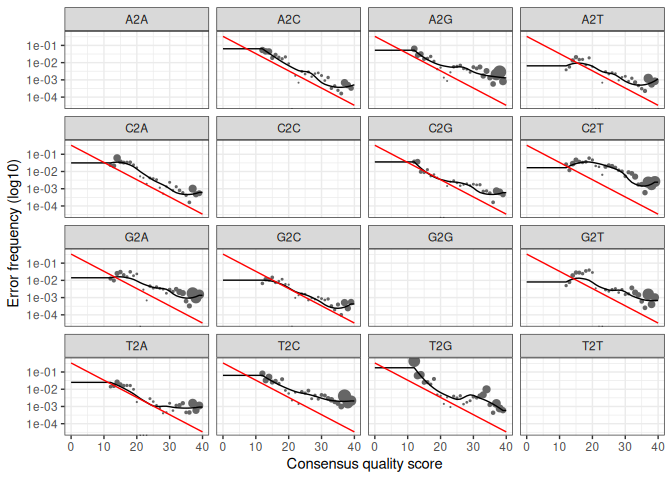
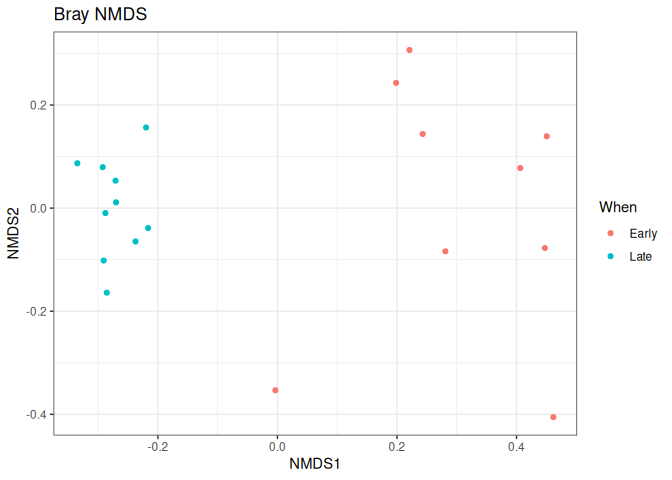
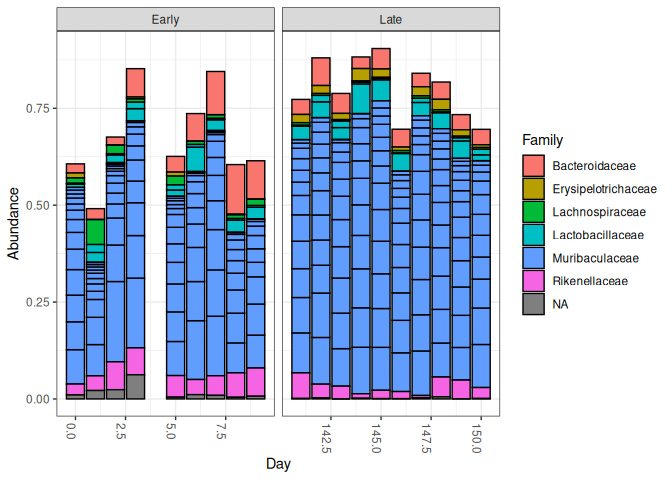

R Notebook
================

Charger le package DADA2.

``` r
library(dada2)
```

Définir le chemin vers le dossier contenant les données et afficher les
fichiers présents.

``` r
path <- "~/Dada-2/MiSeq_SOP"
list.files(path)
```

    ##  [1] "F3D0_S188_L001_R1_001.fastq"   "F3D0_S188_L001_R2_001.fastq"  
    ##  [3] "F3D1_S189_L001_R1_001.fastq"   "F3D1_S189_L001_R2_001.fastq"  
    ##  [5] "F3D141_S207_L001_R1_001.fastq" "F3D141_S207_L001_R2_001.fastq"
    ##  [7] "F3D142_S208_L001_R1_001.fastq" "F3D142_S208_L001_R2_001.fastq"
    ##  [9] "F3D143_S209_L001_R1_001.fastq" "F3D143_S209_L001_R2_001.fastq"
    ## [11] "F3D144_S210_L001_R1_001.fastq" "F3D144_S210_L001_R2_001.fastq"
    ## [13] "F3D145_S211_L001_R1_001.fastq" "F3D145_S211_L001_R2_001.fastq"
    ## [15] "F3D146_S212_L001_R1_001.fastq" "F3D146_S212_L001_R2_001.fastq"
    ## [17] "F3D147_S213_L001_R1_001.fastq" "F3D147_S213_L001_R2_001.fastq"
    ## [19] "F3D148_S214_L001_R1_001.fastq" "F3D148_S214_L001_R2_001.fastq"
    ## [21] "F3D149_S215_L001_R1_001.fastq" "F3D149_S215_L001_R2_001.fastq"
    ## [23] "F3D150_S216_L001_R1_001.fastq" "F3D150_S216_L001_R2_001.fastq"
    ## [25] "F3D2_S190_L001_R1_001.fastq"   "F3D2_S190_L001_R2_001.fastq"  
    ## [27] "F3D3_S191_L001_R1_001.fastq"   "F3D3_S191_L001_R2_001.fastq"  
    ## [29] "F3D5_S193_L001_R1_001.fastq"   "F3D5_S193_L001_R2_001.fastq"  
    ## [31] "F3D6_S194_L001_R1_001.fastq"   "F3D6_S194_L001_R2_001.fastq"  
    ## [33] "F3D7_S195_L001_R1_001.fastq"   "F3D7_S195_L001_R2_001.fastq"  
    ## [35] "F3D8_S196_L001_R1_001.fastq"   "F3D8_S196_L001_R2_001.fastq"  
    ## [37] "F3D9_S197_L001_R1_001.fastq"   "F3D9_S197_L001_R2_001.fastq"  
    ## [39] "filtered"                      "HMP_MOCK.v35.fasta"           
    ## [41] "Mock_S280_L001_R1_001.fastq"   "Mock_S280_L001_R2_001.fastq"  
    ## [43] "mouse.dpw.metadata"            "mouse.time.design"            
    ## [45] "stability.batch"               "stability.files"

``` r
#Identifier et trier les fichiers de séquences forward (R1)
fnFs <- sort(list.files(path, pattern="_R1_001.fastq", full.names = TRUE))

#Identifier et trier les fichiers de séquences reverse (R2)
fnRs <- sort(list.files(path, pattern="_R2_001.fastq", full.names = TRUE))

# Extraire l'identifiant de chaque échantillon (partie avant le premier "_")
sample.names <- sapply(strsplit(basename(fnFs), "_"), `[`, 1)
```

``` r
#Afficher les profils de qualité des deux premiers fichiers R1 pour évaluer la qualité des séquences selon leur position
plotQualityProfile(fnFs[1:2])
```

<!-- --> Les profils de
qualité des lectures forward (R1) montrent une bonne qualité globale,
avec des scores moyens généralement élevés, autour de 35 à 38. Une
diminution de la qualité apparaît vers la fin des lectures, notamment
dans les dernières positions. Les lectures ont été tronqué à la position
240 afin d’éliminer les 10 derniers nucléotides, où la qualité est moins
fiable.

``` r
#Afficher les profils de qualité des deux premiers fichiers R2 pour évaluer la qualité des séquences reverse
plotQualityProfile(fnRs[1:2])
```

<!-- --> Les profils de
qualité des lectures reverse (R2) montrent une bonne qualité au début
des séquences, avec des scores autour de 35 à 38. Cependant, la qualité
diminue fortement à partir d’environ 160 bases et devient très variable
vers la fin. Pour limiter les erreurs de séquençage, les lectures
reverse ont été tronquées à la position 160.

``` r
# Créer le chemin de sortie de chaque fichier R1 filtré :
# file.path() indique le dossier "filtered" où le fichier sera placé.
# paste0() ajoute "_F_filt.fastq.gz" à la fin du nom de chaque échantillon.
filtFs <- file.path(path, "filtered", paste0(sample.names, "_F_filt.fastq.gz"))

# Créer le chemin de sortie de chaque fichier R2 filtré :
# chaque fichier sera placé dans "filtered" et son nom se terminera par "_R_filt.fastq.gz".
filtRs <- file.path(path, "filtered", paste0(sample.names, "_R_filt.fastq.gz"))
```

``` r
# Attribuer à chaque chemin de fichier R1 le nom de l'échantillon correspondant,afin de pouvoir identifier facilement le fichier associé à chaque échantillon.
names(filtFs) <- sample.names

## Faire la même chose pour les chemins des fichiers R2.
names(filtRs) <- sample.names
```

FILTER AND TRIM

``` r
# Filtrer les séquences selon leur qualité et enregistrer les fichiers filtrés.
# truncLen : limiter R1 à 240 bases et R2 à 160 bases.
# maxN = 0 : éliminer les séquences contenant des bases inconnues (N).
# maxEE : accepter au maximum 2 erreurs attendues par séquence.
# truncQ = 2 : couper les séquences lorsque la qualité devient trop faible.
# compress : compresser les fichiers de sortie.
out <- filterAndTrim(fnFs, filtFs, fnRs, filtRs, truncLen=c(240,160),
              maxN=0, maxEE=c(2,2), truncQ=2, rm.phix=TRUE,
              compress=TRUE, multithread=FALSE) 
head(out)
```

    ##                               reads.in reads.out
    ## F3D0_S188_L001_R1_001.fastq       7793      7113
    ## F3D1_S189_L001_R1_001.fastq       5869      5299
    ## F3D141_S207_L001_R1_001.fastq     5958      5463
    ## F3D142_S208_L001_R1_001.fastq     3183      2914
    ## F3D143_S209_L001_R1_001.fastq     3178      2941
    ## F3D144_S210_L001_R1_001.fastq     4827      4312

Learn the Error Rates

``` r
# Apprendre le modèle d'erreurs des séquences R1 et R2 à partir des fichiers filtrés.
errF <- learnErrors(filtFs, multithread=TRUE)
```

    ## 33514080 total bases in 139642 reads from 20 samples will be used for learning the error rates.

``` r
errR <- learnErrors(filtRs, multithread=TRUE)
```

    ## 22342720 total bases in 139642 reads from 20 samples will be used for learning the error rates.

``` r
# Comparer les taux d'erreurs observés avec ceux attendus selon la qualité des bases.
plotErrors(errF, nominalQ=TRUE)
```

    ## Warning in scale_y_log10(): log-10 transformation introduced infinite values.

    ## Warning: Removed 164 rows containing missing values or values outside the scale range (`geom_line()`).
    ## Removed 164 rows containing missing values or values outside the scale range (`geom_line()`).

<!-- -->

Sample Inference

``` r
dadaFs <- dada(filtFs, err=errF, multithread=TRUE)
```

    ## Sample 1 - 7113 reads in 1979 unique sequences.
    ## Sample 2 - 5299 reads in 1639 unique sequences.
    ## Sample 3 - 5463 reads in 1477 unique sequences.
    ## Sample 4 - 2914 reads in 904 unique sequences.
    ## Sample 5 - 2941 reads in 939 unique sequences.
    ## Sample 6 - 4312 reads in 1267 unique sequences.
    ## Sample 7 - 6741 reads in 1756 unique sequences.
    ## Sample 8 - 4560 reads in 1438 unique sequences.
    ## Sample 9 - 15637 reads in 3590 unique sequences.
    ## Sample 10 - 11413 reads in 2762 unique sequences.
    ## Sample 11 - 12017 reads in 3021 unique sequences.
    ## Sample 12 - 5032 reads in 1566 unique sequences.
    ## Sample 13 - 18075 reads in 3707 unique sequences.
    ## Sample 14 - 6250 reads in 1479 unique sequences.
    ## Sample 15 - 4052 reads in 1195 unique sequences.
    ## Sample 16 - 7369 reads in 1832 unique sequences.
    ## Sample 17 - 4765 reads in 1183 unique sequences.
    ## Sample 18 - 4871 reads in 1382 unique sequences.
    ## Sample 19 - 6504 reads in 1709 unique sequences.
    ## Sample 20 - 4314 reads in 897 unique sequences.

``` r
#Identifier les vraies séquences dans les fichiers R1 filtrés en tenant compte des erreurs de séquençage.
```

``` r
dadaRs <- dada(filtRs, err=errR, multithread=TRUE)
```

    ## Sample 1 - 7113 reads in 1660 unique sequences.
    ## Sample 2 - 5299 reads in 1349 unique sequences.
    ## Sample 3 - 5463 reads in 1335 unique sequences.
    ## Sample 4 - 2914 reads in 853 unique sequences.
    ## Sample 5 - 2941 reads in 880 unique sequences.
    ## Sample 6 - 4312 reads in 1286 unique sequences.
    ## Sample 7 - 6741 reads in 1803 unique sequences.
    ## Sample 8 - 4560 reads in 1265 unique sequences.
    ## Sample 9 - 15637 reads in 3414 unique sequences.
    ## Sample 10 - 11413 reads in 2522 unique sequences.
    ## Sample 11 - 12017 reads in 2771 unique sequences.
    ## Sample 12 - 5032 reads in 1415 unique sequences.
    ## Sample 13 - 18075 reads in 3290 unique sequences.
    ## Sample 14 - 6250 reads in 1390 unique sequences.
    ## Sample 15 - 4052 reads in 1134 unique sequences.
    ## Sample 16 - 7369 reads in 1635 unique sequences.
    ## Sample 17 - 4765 reads in 1084 unique sequences.
    ## Sample 18 - 4871 reads in 1161 unique sequences.
    ## Sample 19 - 6504 reads in 1502 unique sequences.
    ## Sample 20 - 4314 reads in 732 unique sequences.

``` r
#Identifier les vraies séquences dans les fichiers R2 filtrés en tenant compte des erreurs de séquençage.
```

``` r
#Afficher les résultats de l'inférence pour le premier échantillon R1.
dadaFs[[1]]
```

    ## dada-class: object describing DADA2 denoising results
    ## 128 sequence variants were inferred from 1979 input unique sequences.
    ## Key parameters: OMEGA_A = 1e-40, OMEGA_C = 1e-40, BAND_SIZE = 16

Merge paired reads

``` r
#Fusionner les séquences R1 et R2 correspondantes pour reconstituer les séquences complètes
mergers <- mergePairs(dadaFs, filtFs, dadaRs, filtRs, verbose=FALSE)

# afficher les premières lignes des résultats de fusion du premier échantillon.
print(head(mergers[[1]]))
```

    ##                                                                                                                                                                                                                                                       sequence
    ## 1 TACGGAGGATGCGAGCGTTATCCGGATTTATTGGGTTTAAAGGGTGCGCAGGCGGAAGATCAAGTCAGCGGTAAAATTGAGAGGCTCAACCTCTTCGAGCCGTTGAAACTGGTTTTCTTGAGTGAGCGAGAAGTATGCGGAATGCGTGGTGTAGCGGTGAAATGCATAGATATCACGCAGAACTCCGATTGCGAAGGCAGCATACCGGCGCTCAACTGACGCTCATGCACGAAAGTGTGGGTATCGAACAGG
    ## 2 TACGGAGGATGCGAGCGTTATCCGGATTTATTGGGTTTAAAGGGTGCGTAGGCGGCCTGCCAAGTCAGCGGTAAAATTGCGGGGCTCAACCCCGTACAGCCGTTGAAACTGCCGGGCTCGAGTGGGCGAGAAGTATGCGGAATGCGTGGTGTAGCGGTGAAATGCATAGATATCACGCAGAACCCCGATTGCGAAGGCAGCATACCGGCGCCCTACTGACGCTGAGGCACGAAAGTGCGGGGATCAAACAGG
    ## 3 TACGGAGGATGCGAGCGTTATCCGGATTTATTGGGTTTAAAGGGTGCGTAGGCGGGCTGTTAAGTCAGCGGTCAAATGTCGGGGCTCAACCCCGGCCTGCCGTTGAAACTGGCGGCCTCGAGTGGGCGAGAAGTATGCGGAATGCGTGGTGTAGCGGTGAAATGCATAGATATCACGCAGAACTCCGATTGCGAAGGCAGCATACCGGCGCCCGACTGACGCTGAGGCACGAAAGCGTGGGTATCGAACAGG
    ## 4 TACGGAGGATGCGAGCGTTATCCGGATTTATTGGGTTTAAAGGGTGCGTAGGCGGGCTTTTAAGTCAGCGGTAAAAATTCGGGGCTCAACCCCGTCCGGCCGTTGAAACTGGGGGCCTTGAGTGGGCGAGAAGAAGGCGGAATGCGTGGTGTAGCGGTGAAATGCATAGATATCACGCAGAACCCCGATTGCGAAGGCAGCCTTCCGGCGCCCTACTGACGCTGAGGCACGAAAGTGCGGGGATCGAACAGG
    ## 5 TACGGAGGATGCGAGCGTTATCCGGATTTATTGGGTTTAAAGGGTGCGCAGGCGGACTCTCAAGTCAGCGGTCAAATCGCGGGGCTCAACCCCGTTCCGCCGTTGAAACTGGGAGCCTTGAGTGCGCGAGAAGTAGGCGGAATGCGTGGTGTAGCGGTGAAATGCATAGATATCACGCAGAACTCCGATTGCGAAGGCAGCCTACCGGCGCGCAACTGACGCTCATGCACGAAAGCGTGGGTATCGAACAGG
    ## 6 TACGGAGGATGCGAGCGTTATCCGGATTTATTGGGTTTAAAGGGTGCGTAGGCGGGATGCCAAGTCAGCGGTAAAAAAGCGGTGCTCAACGCCGTCGAGCCGTTGAAACTGGCGTTCTTGAGTGGGCGAGAAGTATGCGGAATGCGTGGTGTAGCGGTGAAATGCATAGATATCACGCAGAACTCCGATTGCGAAGGCAGCATACCGGCGCCCTACTGACGCTGAGGCACGAAAGCGTGGGTATCGAACAGG
    ##   abundance forward reverse nmatch nmismatch nindel prefer accept
    ## 1       579       1       1    148         0      0      1   TRUE
    ## 2       470       2       2    148         0      0      2   TRUE
    ## 3       449       3       4    148         0      0      1   TRUE
    ## 4       430       4       3    148         0      0      2   TRUE
    ## 5       345       5       6    148         0      0      1   TRUE
    ## 6       282       6       5    148         0      0      2   TRUE

Construct sequence table

``` r
#Construire une table regroupant les séquences fusionnées de tous les échantillons.
seqtab <- makeSequenceTable(mergers)
#dimension de la table
dim(seqtab)
```

    ## [1]  20 293

``` r
# récupère les séquences d'ADN présentes dans la table et compter combien de séquences ont chaque longueur

table(nchar(getSequences(seqtab)))
```

    ## 
    ## 251 252 253 254 255 
    ##   1  88 196   6   2

Remove chimeras

``` r
## Retirer de la table les séquences chimères, qui peuvent résulter de l'assemblage de fragments d'ADN différents.
seqtab.nochim <- removeBimeraDenovo(seqtab, method="consensus", multithread=TRUE, verbose=TRUE)
```

    ## Identified 61 bimeras out of 293 input sequences.

``` r
#dimension
dim(seqtab.nochim)
```

    ## [1]  20 232

``` r
#Calculer la proportion des séquences conservées après le retrait des chimères
sum(seqtab.nochim)/sum(seqtab)
```

    ## [1] 0.9640374

Track reads through the pipeline

``` r
# Créer une fonction qui calcule le nombre total de séquences dans un échantillon.
getN <- function(x) sum(getUniques(x))

# Regrouper dans un tableau le nombre de séquences conservées à chaque étape :
# filtrage, correction des erreurs R1/R2, fusion et élimination des chimères.
track <- cbind(out, sapply(dadaFs, getN), sapply(dadaRs, getN), sapply(mergers, getN), rowSums(seqtab.nochim))

# Donner un nom aux colonnes selon les différentes étapes du traitement.
colnames(track) <- c("input", "filtered", "denoisedF", "denoisedR", "merged", "nonchim")

# Associer chaque ligne du tableau au nom de l'échantillon correspondant.
rownames(track) <- sample.names

# Afficher les six premières lignes du tableau récapitulatif.
head(track)
```

    ##        input filtered denoisedF denoisedR merged nonchim
    ## F3D0    7793     7113      6976      6979   6540    6528
    ## F3D1    5869     5299      5227      5239   5028    5017
    ## F3D141  5958     5463      5331      5357   4986    4863
    ## F3D142  3183     2914      2799      2830   2595    2521
    ## F3D143  3178     2941      2822      2868   2553    2519
    ## F3D144  4827     4312      4151      4228   3646    3507

``` bash
cd ~/Dada-2/MiSeq_SOP
```

``` r
#Attribuer une classification taxonomique aux séquences sans chimères à l'aide de la base SILVA.

taxa <- assignTaxonomy(
  seqtab.nochim,
  "~/Dada-2/silva_nr99_v138.2_toGenus_trainset.fa.gz?download=1.1",
  multithread=TRUE
)
```

``` r
# Ajouter le nom des espèces aux classifications taxonomiques obtenues précédemment.
taxa <- addSpecies(taxa, "~/Dada-2/silva_v138.2_assignSpecies.fa.gz?download=1")
```

``` r
# copier la classification dans taxa.print, sans modifier taxa
taxa.print <- taxa

# Supprimer les noms des lignes uniquement dans cette copie, pour rendre l'affichage plus lisible.
rownames(taxa.print) <- NULL

#afficher
head(taxa.print)
```

    ##      Kingdom    Phylum         Class         Order           Family           Genus        
    ## [1,] "Bacteria" "Bacteroidota" "Bacteroidia" "Bacteroidales" "Muribaculaceae" NA           
    ## [2,] "Bacteria" "Bacteroidota" "Bacteroidia" "Bacteroidales" "Muribaculaceae" NA           
    ## [3,] "Bacteria" "Bacteroidota" "Bacteroidia" "Bacteroidales" "Muribaculaceae" NA           
    ## [4,] "Bacteria" "Bacteroidota" "Bacteroidia" "Bacteroidales" "Muribaculaceae" NA           
    ## [5,] "Bacteria" "Bacteroidota" "Bacteroidia" "Bacteroidales" "Bacteroidaceae" "Bacteroides"
    ## [6,] "Bacteria" "Bacteroidota" "Bacteroidia" "Bacteroidales" "Muribaculaceae" NA           
    ##      Species
    ## [1,] NA     
    ## [2,] NA     
    ## [3,] NA     
    ## [4,] NA     
    ## [5,] NA     
    ## [6,] NA

Evaluate accuracy

``` r
#extraire les séquences observées dans le témoin "Mock".
unqs.mock <- seqtab.nochim["Mock",]

#garder uniquement les séquences présentes (abondance > 0) et les trier par abondance décroissante
unqs.mock <- sort(unqs.mock[unqs.mock>0], decreasing=TRUE)

#afficher le nombre de séquences différentes identifiées par DADA2 dans le témoin Mock.
cat("DADA2 inferred", length(unqs.mock), "sample sequences present in the Mock community.\n")
```

    ## DADA2 inferred 20 sample sequences present in the Mock community.

``` r
#Charge les séquences de référence attendues pour la communauté témoin Mock.
mock.ref <- getSequences(file.path(path, "HMP_MOCK.v35.fasta"))

#compte les séquences détectées dans le Mock qui correspondent exactement à une séquence de référence.
match.ref <- sum(sapply(names(unqs.mock), function(x) any(grepl(x, mock.ref))))

#Afficher le nombre de correspondances exactes avec les séquences de référence attendues
cat("Of those,", sum(match.ref), "were exact matches to the expected reference sequences.\n")
```

    ## Of those, 20 were exact matches to the expected reference sequences.

Phyloseq

``` r
library(phyloseq)
packageVersion("phyloseq")
```

    ## [1] '1.56.0'

``` r
library(Biostrings); packageVersion("Biostrings")
```

    ## [1] '2.80.2'

``` r
library(ggplot2); packageVersion("ggplot2")
```

    ## [1] '4.0.3'

``` r
## Appliquer le thème noir et blanc aux graphiques ggplot2
theme_set(theme_bw())
```

``` r
#récupère les noms des échantillons présents dans la table sans chimères.
samples.out <- rownames(seqtab.nochim)

#Extraire la partie du nom située avant la lettre "D" pour identifier le sujet.
subject <- sapply(strsplit(samples.out, "D"), `[`, 1)

#Récupérer la première lettre du sujet pour identifier son genre.
gender <- substr(subject,1,1)

#Retirer la première lettre
subject <- substr(subject,2,999)
#Extraire la partie située après "D" et la convertir en nombre 
day <- as.integer(sapply(strsplit(samples.out, "D"), `[`, 2))

#Regrouper le sujet, son genre et le jour dans un tableau de métadonnées
samdf <- data.frame(Subject=subject, Gender=gender, Day=day)

samdf$When <- "Early"
samdf$When[samdf$Day>100] <- "Late"

# Associer chaque ligne du tableau au nom de l'échantillon correspondant.
rownames(samdf) <- samples.out
```

``` r
#Construire phyloseq en regroupant les abondances, les métadonnées et la classification taxonomique
ps <- phyloseq(otu_table(seqtab.nochim, taxa_are_rows=FALSE),
               sample_data(samdf),
               tax_table(taxa))


# Retirer l'échantillon témoin "Mock" de l'analyse.
ps <- prune_samples(sample_names(ps) != "Mock", ps) 
```

``` r
#les séquences d'ADN en objets DNAStringSet pour les conserver dans un format adapté aux séquences biologiques

dna <- Biostrings::DNAStringSet(taxa_names(ps))

# Attribuer à chaque séquence son identifiant taxonomique d'origine
names(dna) <- taxa_names(ps)

# Ajouter les séquences d'ADN à phyloseq
ps <- merge_phyloseq(ps, dna)

#Remplacer les identifiants des séquences par des: ASV1, ASV2, ASV3, e
taxa_names(ps) <- paste0("ASV", seq(ntaxa(ps)))

#Afficher phyloseq mis à jour
ps
```

    ## phyloseq-class experiment-level object
    ## otu_table()   OTU Table:         [ 232 taxa and 19 samples ]
    ## sample_data() Sample Data:       [ 19 samples by 4 sample variables ]
    ## tax_table()   Taxonomy Table:    [ 232 taxa by 7 taxonomic ranks ]
    ## refseq()      DNAStringSet:      [ 232 reference sequences ]

Visualize alpha-diversity:

``` r
#Shannon et Simpson mesurent la diversité, et la color distingue les périodes Early et Late
plot_richness(ps, x="Day", measures=c("Shannon", "Simpson"), color="When")
```

    ## Warning in estimate_richness(physeq, split = TRUE, measures = measures): The data you have provided does not have
    ## any singletons. This is highly suspicious. Results of richness
    ## estimates (for example) are probably unreliable, or wrong, if you have already
    ## trimmed low-abundance taxa from the data.
    ## 
    ## We recommended that you find the un-trimmed data and retry.

<!-- --> Indice de
Shannon : les valeurs varient dans les deux périodes, sans différence
nette et systématique. Indice de Simpson : les valeurs sont également
assez proches entre les deux périodes. on peut observer que la diversité
microbienne semble globalement comparable entre les échantillons
prélevés tôt et tard

``` r
# Transformer les abondances en proportions pour chaque échantillon
ps.prop <- transform_sample_counts(ps, function(otu) otu/sum(otu))

#Réaliser une ordination NMDS
ord.nmds.bray <- ordinate(ps.prop, method="NMDS", distance="bray")
```

    ## Run 0 stress 0.08043117 
    ## Run 1 stress 0.08076342 
    ## ... Procrustes: rmse 0.01057174  max resid 0.03254817 
    ## Run 2 stress 0.08076338 
    ## ... Procrustes: rmse 0.01054193  max resid 0.03245158 
    ## Run 3 stress 0.08616061 
    ## Run 4 stress 0.08616061 
    ## Run 5 stress 0.1212044 
    ## Run 6 stress 0.1010632 
    ## Run 7 stress 0.08076338 
    ## ... Procrustes: rmse 0.01052722  max resid 0.03240343 
    ## Run 8 stress 0.08043116 
    ## ... New best solution
    ## ... Procrustes: rmse 3.149573e-06  max resid 9.226331e-06 
    ## ... Similar to previous best
    ## Run 9 stress 0.08616061 
    ## Run 10 stress 0.08043117 
    ## ... Procrustes: rmse 3.362469e-06  max resid 1.006721e-05 
    ## ... Similar to previous best
    ## Run 11 stress 0.08076337 
    ## ... Procrustes: rmse 0.01050545  max resid 0.03233023 
    ## Run 12 stress 0.1297738 
    ## Run 13 stress 0.08616061 
    ## Run 14 stress 0.1432849 
    ## Run 15 stress 0.1212044 
    ## Run 16 stress 0.08616061 
    ## Run 17 stress 0.1228545 
    ## Run 18 stress 0.09477208 
    ## Run 19 stress 0.08616061 
    ## Run 20 stress 0.1212044 
    ## *** Best solution repeated 2 times

``` r
plot_ordination(ps.prop, ord.nmds.bray, color="When", title="Bray NMDS")
```

<!-- --> On observe
une séparation nette entre les échantillons Early et Late, ce qui
suggère une différence de composition des communautés microbiennes entre
les deux périodes.

``` r
# Identification des 20 taxons les plus abondants dans l'ensemble des échantillons et classe par ordre décroissant
top20 <- names(sort(taxa_sums(ps), decreasing=TRUE))[1:20]

# Transformer les abondances en proportions pour chaque échantillon.
ps.top20 <- transform_sample_counts(ps, function(OTU) OTU/sum(OTU))

# Conserver uniquement les 20 taxons sélectionnés
ps.top20 <- prune_taxa(top20, ps.top20)
```

``` r
#Représenter l'abondance relative des familles selon le jour de prélèvement, en séparant les périodes Early et Late dans deux panneaux
plot_bar(ps.top20, x="Day", fill="Family") + facet_wrap(~When, scales="free_x")
```

<!-- --> La
répartition des familles microbiennes ne montre pas de différence
évidente permettant d’expliquer la séparation Early/Late observée sur le
graphique NMDS.
